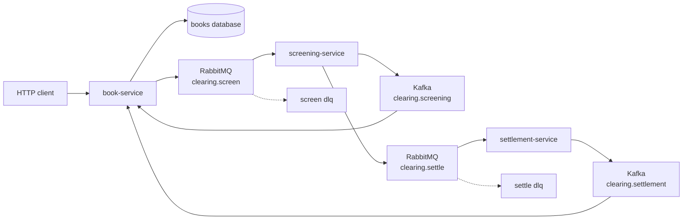
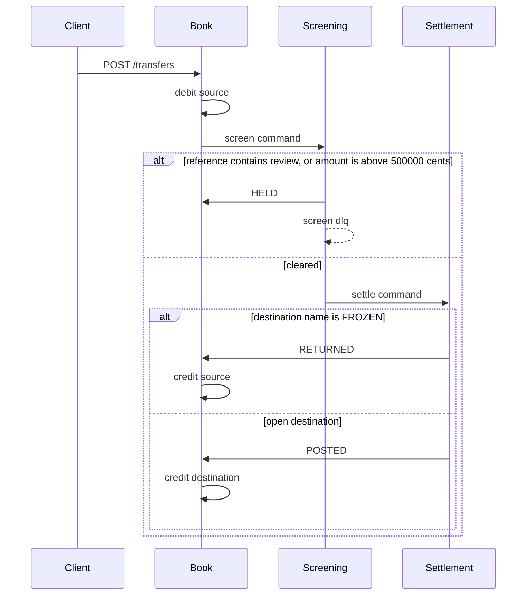

# Clearing Desk

One account pays another. The book debits the source when the transfer is accepted. Screening either clears it or holds it. Settlement posts the credit, or returns the debit when the destination name is exactly `FROZEN`.

A held transfer keeps the debit. Nothing in this stack releases a hold. A returned transfer credits the source once. The three services do not call each other, and settlement never writes the account balance itself.





## Why three services

The balance moves in one SQL statement. Overlapping transfers cannot spend the same cent twice, and a posted credit cannot land twice: the status change and the credit commit together. `500000` cents clears. `500001` cents is held. The name `frozen` is an ordinary account. Only `FROZEN` comes back.

The screen command is sent after the debit commits. There is no outbox. A crash in that gap leaves a debit with no screening task.

## Run

JDK 17, Maven 3.9, and Docker.

```bash
mvn -q -DskipTests package
docker compose up --build -d
./scripts/smoke.sh
```

| Process | URL |
| --- | --- |
| book-service | http://localhost:8131 |
| screening-service | http://localhost:8132 |
| settlement-service | http://localhost:8133 |
| RabbitMQ management | http://localhost:15678 |
| Postgres | localhost:5438 |
| Kafka (host listener) | localhost:9099 |

```bash
docker compose down
```

## Calls

```bash
curl -s -X POST localhost:8131/accounts \
  -H 'content-type: application/json' \
  -d '{"name":"Ana","balanceCents":10000}'

curl -s -X POST localhost:8131/transfers \
  -H 'content-type: application/json' \
  -d '{"fromAccountId":"'$FROM'","toAccountId":"'$TO'","amountCents":4000,"reference":"invoice"}'

curl -s localhost:8131/transfers/$TRANSFER
curl -s localhost:8131/accounts/$FROM
curl -s localhost:8133/postings/$TRANSFER
```

An unknown account answers `404`. A transfer the balance cannot cover answers `409` and writes no transfer. A same-account transfer answers `400`.

## Where the same split goes on Azure

This repository runs on Compose. Nothing in it calls a cloud account.

| Compose | Azure |
| --- | --- |
| Postgres 16 | Azure Database for PostgreSQL |
| Kafka 3.8 | Event Hubs |
| RabbitMQ 3.13 | Service Bus queue, with its dead-letter sub-queue |
| the three services | Container Apps or AKS |

## Local credentials

The Compose network is open. Do not publish these ports.

| | |
| --- | --- |
| Postgres | `platform` / `platform` |
| RabbitMQ | `platform` / `platform`, vhost `/` |
| HTTP | no authentication |

## Tests

`mvn test` checks the hold line and the frozen name with no Docker. `./scripts/smoke.sh` posts a normal transfer, holds one whose reference contains `review`, returns a transfer to `FROZEN`, posts one to an account named `frozen`, clears `500000` cents, holds `500001` cents, and fires ten transfers of 10 against a balance of 50.

## Same shape, different domain

- [Live Lobby](https://github.com/joshbarros/java-live-lobby)
- [Loyalty Ledger](https://github.com/joshbarros/java-loyalty-ledger)
- [Claims Desk](https://github.com/joshbarros/java-claims-desk)
- [Checkout Counter](https://github.com/joshbarros/java-checkout-counter)
- [Study Hall](https://github.com/joshbarros/java-study-hall)
- [Thread Hall](https://github.com/joshbarros/java-thread-hall)
- [Yard Gate](https://github.com/joshbarros/java-yard-gate)
